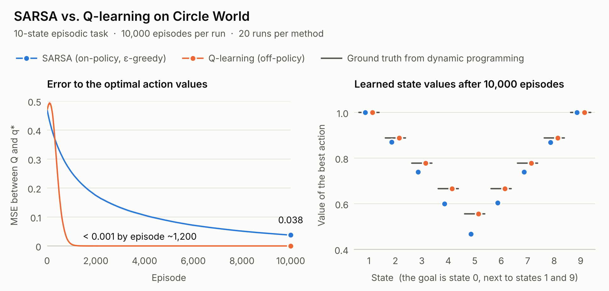

# Tabular reinforcement learning on Circle World

Final assignment for the Reinforcement Learning course at Radboud University (2024). The notebook implements the core tabular RL algorithms from scratch in NumPy and checks them against an exact ground truth on *Circle World*, a small MDP whose optimal policy and value functions are known.



Both methods end up with the optimal greedy policy in all 20 runs, but they learn different things on the way. Q-learning learns off-policy from a uniformly random behaviour policy, so every action value gets updated often, and its error to q\* drops below 0.001 within about 1,200 episodes. SARSA follows its own ε-greedy policy (ε = 0.1) and seldom tries the non-greedy action: 97% of its remaining error sits in those rarely tried actions. Its state values also sit slightly below v\*, because SARSA learns the value of the exploring policy it actually follows, which now and then steps the wrong way.

<sub>Made with the notebook's own `sarsa` and `qlearning` functions, learning rate α = 0.01. MSE is taken over all state–action pairs. Lines show the mean of 20 runs; the 10th–90th percentile band is barely wider than the line. The ground truth comes from iterative policy evaluation of the optimal policy (Part 2).</sub>

## Circle World

The agent walks a ring of 10 states and can step left or right. Every step costs −1/9 and reaching the goal, state 0, earns +1, so the best policy is to take the shorter way round. The notebook uses two versions: an episodic one where state 0 ends the episode (γ = 1), and a continuing one with no terminal state (γ = 0.99).

## What's in the notebook

| Part | Topic | Implemented |
|---|---|---|
| 1 | Markov decision processes | Random policies, sampled episodes, returns under γ = 1, 0.99 and 0.8 |
| 2 | Dynamic programming | Iterative policy evaluation, policy iteration, value iteration |
| 3 | Monte Carlo methods | First-visit MC prediction, on-policy MC control with ε-soft policies |
| 4 | Temporal-difference learning | TD(0) prediction, SARSA, Q-learning |
| 5 | Comparison (bonus) | MC control, SARSA and Q-learning on a 10-state vs. a 50-state Circle World |

## Running it

```bash
pip install numpy pandas matplotlib gymnasium jupyter
jupyter notebook assignment.ipynb
```
